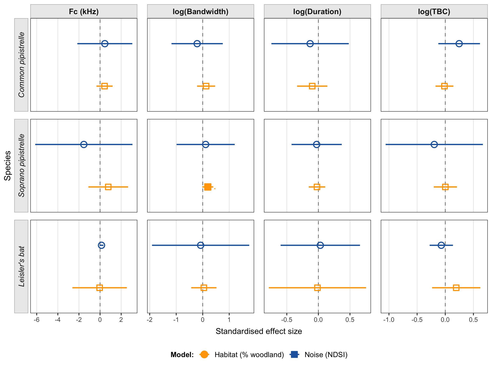

# Noisy neighbours: anthropogenic noise and bat echolocation near the M25

Final-year undergraduate thesis using **passive acoustic monitoring** to test whether anthropogenic noise from the M25 motorway is associated with shifts in **pulse-level echolocation call parameters** of bats. The study area is Copped Hall and Patmore Fields, Epping Forest (Essex, UK), an area of active rewilding managed by the City of London Corporation.

*BSc Ecology and Environmental Biology, Imperial College London, June 2026. Fieldwork in collaboration with the City of London Corporation; analysis and thesis by Markéta Šimková.*

📄 **Thesis:** [`report/Simkova_2026_noisy_neighbours_thesis.pdf`](report/Simkova_2026_noisy_neighbours_thesis.pdf)



## Questions
1. Does anthropogenic noise, measured by the Normalised Difference Soundscape Index (NDSI), predict characteristic frequency, bandwidth, duration or time between calls in bat echolocation pulses?
2. How do these call parameters relate to local habitat (woodland cover) and weather?

## Methods
- **Monitoring:**
  - Song Meter Mini Bat 2 detectors at 13 sites, 10 March – 27 April 2026.
  - Triggered ultrasonic recordings for bats, plus 48 kHz ambient recordings for noise.
  - Sites 2, 6 and 7 yielded too little data for the call analysis.
- **Species identification:** Kaleidoscope Pro 5.7.0 (Bats of Europe classifier). Noise and No-ID files were removed, and only identifications with a match ratio of at least 0.8 were kept. One bat pass is one or more calls of a species within 5 seconds.
- **Noise:** NDSI (`soundecology`) from 30 ambient files per site and window, stratified by night. Two windows were compared: high noise (19:00–22:00) and low noise (03:00–06:00).
- **Covariates:** nightly minimum temperature and mean humidity, plus the proportion of woodland within 200 m of each detector (UKCEH Land Cover Map).
- **Call parameters:** pulses were re-extracted from the WAV files with `bioacoustics`, giving characteristic frequency (Fc), bandwidth, duration and time between calls (TBC). Each species' Fc was limited to its biologically plausible range.
- **Models:** linear mixed models (`lme4`/`lmerTest`) for the three focal species: common pipistrelle, soprano pipistrelle and Leisler's bat.
  - Noise model: `Response ~ [noise window] + NDSI + temperature + humidity + (1 | site/file)`
  - Habitat model: the same, with woodland cover in place of NDSI.
  - Continuous predictors are standardised; duration, bandwidth and TBC are log-transformed.
  - Marginal and conditional R² from `MuMIn`.

## Key results
- **Activity:** 30,235 triggered recordings were made over the season, and 15 bat species were identified.
- **Analysis window (11–18 March):** 4,371 pulses from 437 files were analysed: 2,448 common pipistrelle, 1,140 soprano pipistrelle and 783 Leisler's bat.
- **NDSI did not significantly predict any call parameter in any species.** Anthropogenic sound dominated almost every site: mean NDSI ranged from −0.95 to 0.51, and most sites were below −0.6.
- **Temperature was the most consistent predictor:**
  - Characteristic frequency was lower on warmer nights (common pipistrelle β = −0.55, p = 0.005; soprano pipistrelle β = −1.75, p = 0.001).
  - Calls were longer on warmer nights (common pipistrelle β = 0.053, p = 0.004; soprano pipistrelle β = 0.095, p = 0.025).
- **Fixed effects explained little variance:** marginal R² ≤ 0.19, against conditional R² up to 0.70. Most variation was between recordings and sites.
- **Delivered to the City of London Corporation:** species identification data and a report for its habitat restoration programme.

## Reproducing the analysis
Tested with R 4.6.2; package versions are pinned in `renv.lock`. From the repository root:

```r
install.packages("renv")
renv::restore()        # installs the pinned package versions
source("run_all.R")    # or, from a shell: Rscript run_all.R
```

`run_all.R` refits all 24 mixed models and rebuilds Figures 4–5, Table 2 and Appendices F and H from the tables in `data/raw/`. It takes about a minute. The audio-processing steps that produced those tables are described in [`data/README.md`](data/README.md):
- Kaleidoscope identification
- NDSI calculation
- pulse extraction
- woodland cover

Those steps need the raw WAV files and the licensed UKCEH land-cover raster, which are not included. Figures 1–3 (an echolocation diagram and two satellite site maps) were made outside R and appear only in the thesis PDF.

| Output | Thesis |
|---|---|
| `outputs/figures/fig4_passes_per_site.png` | Figure 4 |
| `outputs/figures/fig5_lmm_effects.png` | Figure 5 |
| `outputs/tables/table2_focal_passes.csv` | Table 2 |
| `outputs/tables/lmm_results.csv` | Appendix F |
| `outputs/tables/lmm_r2.csv` | Appendix H |
| `outputs/tables/lmm_variance_partition.csv`, `outputs/figures/figS1_lmm_diagnostics.pdf` | Model checks (Methods 2.6) |
| `data/raw/ndsi_by_site_window.csv`, `data/raw/woodland_200m.csv`, `data/raw/sites.csv` | Appendices E, B and G |

## Repository structure
```
├── run_all.R                       # runs the full pipeline
├── R/
│   ├── 00_setup.R                  # packages, paths, focal species, colours
│   ├── 01_bat_activity.R           # passes per site and species (Fig. 4), Table 2
│   ├── 02_lmm_models.R             # 24 LMMs, R², variance partition, diagnostics
│   └── 03_effect_sizes_figure.R    # Figure 5
├── data/raw/                       # analysis tables (see data/README.md)
├── outputs/
│   ├── figures/                    # generated
│   └── tables/                     # generated
└── report/                         # thesis (PDF)
```

## Licence
- **Code:** MIT ([LICENSE](LICENSE)).
- **Data in `data/raw/`:** CC BY 4.0.

## Citation
Šimková, M. (2026). *Noisy neighbours: passive acoustic monitoring of bat echolocation call parameters in a noise-polluted landscape.* BSc thesis, Imperial College London. See [`CITATION.cff`](CITATION.cff).
